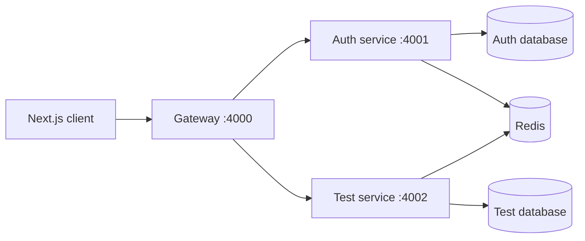

# next-express-micro

Production-minded Express microservices template for Docker on a VPS.

## Architecture



The gateway is the only public API entry point. It strips spoofable identity
headers, verifies bearer JWTs or exchanges web cookies for a short-lived JWT,
then adds `x-user-id`, `x-user-role`, and `x-internal-secret` for the target
service. Services trust only the internal secret and never verify JWTs.

Each service owns its Drizzle schema, migrations, and database. Shared runtime
code is in `packages/service-kit`; cross-service contracts are in
`packages/types` and `packages/validation`.

## Quick start

```bash
pnpm install
pnpm infra:up
pnpm --filter auth-service db:generate
pnpm --filter test-service db:generate
pnpm dev
```

Copy each `apps/*/.env.example` to `.env` and set one shared
`INTERNAL_SECRET`. The Next rewrite uses `GATEWAY_URL` at build time, so the
client Dockerfile passes it as a build argument.

## Adding a service

```bash
pnpm gen:service
pnpm install
pnpm infra:up
pnpm --filter <name>-service db:generate
pnpm dev
```

The generator creates the standard controllers/services/queries/routes/tests
layout and updates the gateway registry and compose file. If the service
publishes or consumes events, add the event to `EventMap`, `eventSubscribers`,
and `eventSchemas`. Keep event handlers idempotent.

## Events

BullMQ uses one queue per subscribing service (`events.<service>`), so events
remain queued while a subscriber is down. Jobs retry five times with
exponential backoff. Completed jobs are bounded; failed jobs are retained as
dead letters and can be inspected with BullMQ tools or Redis queue commands.

## Non-web clients

Sign in through `/api/auth/*`, obtain a JWT from `/api/auth/token`, then call
the gateway with `Authorization: Bearer <token>`. JWTs expire according to
`JWT_EXPIRES_IN` and are not immediately revocable. Web cookie exchanges are
cached only for `COOKIE_EXCHANGE_CACHE_TTL_MS`.

## Environment

| Variable | Used by | Purpose |
| --- | --- | --- |
| `INTERNAL_SECRET` | gateway/services | Private service authentication |
| `DATABASE_URL` | each service | Service-owned PostgreSQL database |
| `REDIS_URL` | gateway/event services | Redis connection |
| `AUTH_SERVICE_URL`, `TEST_SERVICE_URL` | gateway | Internal service URLs |
| `JWT_ISSUER`, `JWT_AUDIENCE`, `JWKS_URL` | gateway/auth | JWT verification |
| `BETTER_AUTH_URL`, `TRUSTED_ORIGINS` | auth | Public auth origin |

## Intentionally not included

- Kubernetes, service discovery, and API versioning
- Distributed tracing and an outbox pattern
- GraphQL or a true pub/sub broker
- Immediate JWT revocation
